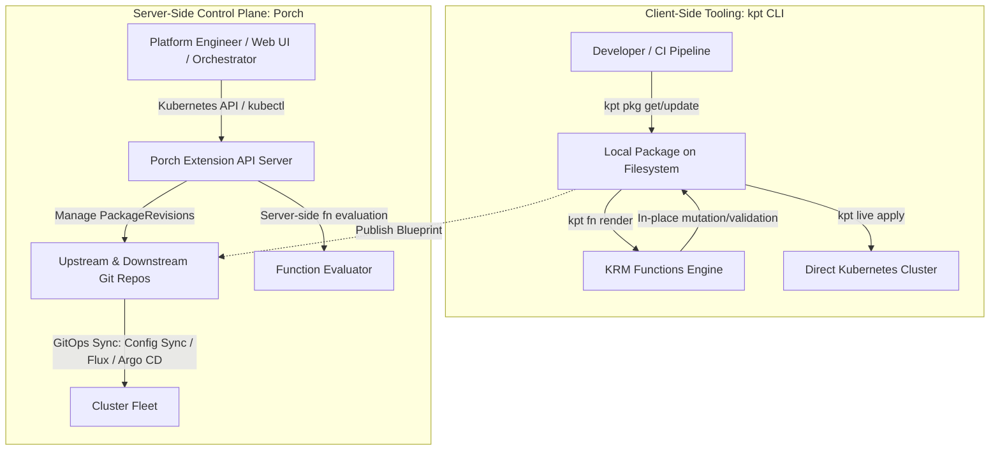
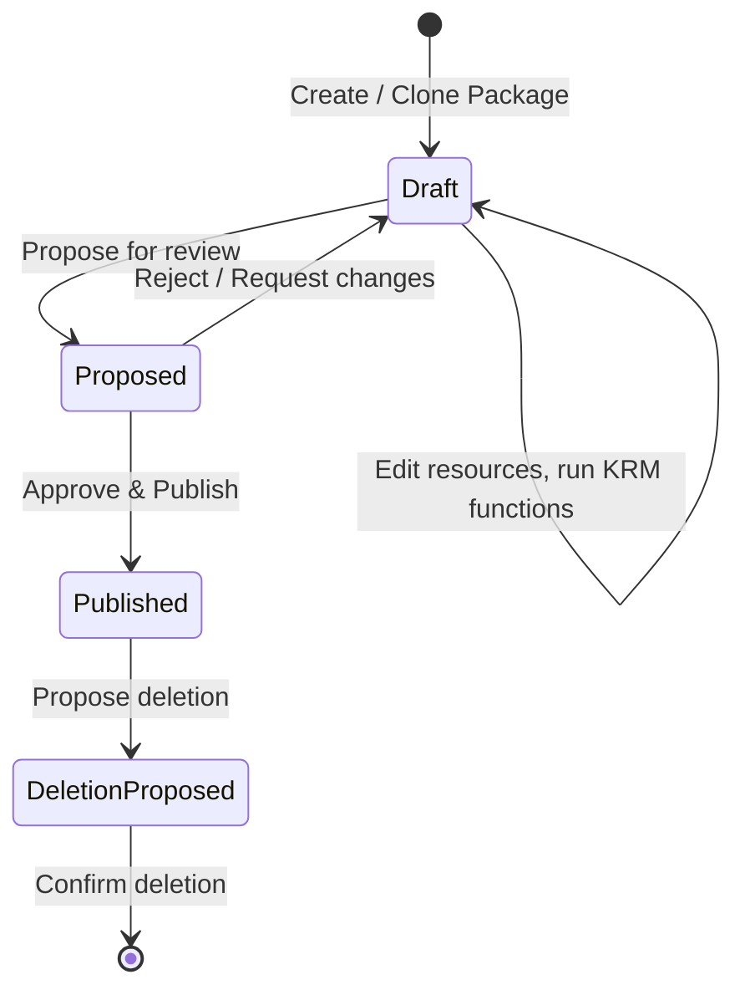
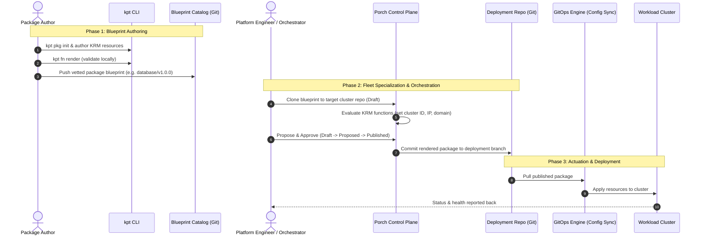

Managing Kubernetes configuration across multiple environments, dozens of clusters, and distributed teams is one of the most demanding challenges in cloud-native platforms. Traditional approaches—such as imperative scripts, monolithic Helm charts with hundreds of parameters, or complex domain-specific languages (DSLs)—frequently lead to configuration drift, excessive templating complexity, and brittle delivery pipelines.

The **kpt** project addresses this challenge through the **Configuration as Data (CaD)** paradigm, delivering a comprehensive ecosystem built on two complementary pillars:

1. **kpt**: A client-side, package-centric CLI and toolchain for authoring, transforming, and deploying configuration.
2. **Porch (Package Orchestration)**: A Kubernetes-native server-side control plane that turns package management into a declarative, multi-repository service.

This guide provides a high-level, 10,000-meter architectural view of how kpt and Porch fit together, their shared foundation, and how they empower teams to manage configuration at enterprise scale.

---

## The Foundation: Configuration as Data (CaD)

At the heart of both kpt and Porch is the principle of **Configuration as Data**:

* **Declarative and Uniform**: Configuration is represented purely as data conforming to the [Kubernetes Resource Model (KRM)](https://github.com/kubernetes/design-proposals-archive/blob/main/architecture/resource-management.md), stored directly as serializable YAML/JSON.
* **Separation of Code and Data**: Instead of embedding programming logic or template directives inside configuration files (such as `{{ if .Values.enabled }}`), configuration files remain clean KRM data.
* **In-Place Transformation via KRM Functions**: Specialized, containerized programs (KRM functions) read KRM resources from an input stream, mutate or validate them, and output the updated resources in-place.
* **Versioned Source of Truth**: Configuration is stored separately from live state in versioned repositories. Git is a common choice, while Porch also supports OCI repositories.

By keeping configuration as plain data, machines, controllers, and humans can read, modify, and validate the same configuration without losing comments, structure, or schema fidelity.

---

## The Two Pillars

While kpt and Porch share the same package format and philosophy, they operate at different layers of the infrastructure stack:

### 1. kpt (The Client-Side Engine)

**kpt** is a client-side command-line tool optimized for developers, platform engineers, and CI/CD pipelines working locally or within workflow runners.

* **Package Management (`kpt pkg`)**: Fetches, inspects, and versions packages from remote Git repositories. It uses **3-way merge** (`kpt pkg update`) to intelligently integrate upstream updates while preserving local modifications.
* **Function Pipelines (`kpt fn`)**: Executes pipelines of containerized or binary KRM functions declared in the `Kptfile` to mutate (e.g., set namespace, add labels, inject sidecars) or validate (e.g., check resource quotas, verify schema constraints) configuration files in-place.
* **Actuation and Inventory (`kpt live`)**: Directly applies rendered packages to a target Kubernetes cluster with resource pruning, dependency ordering, and real-time status monitoring via the ResourceGroup inventory model.

### 2. Porch (The Server-Side Control Plane)

**Porch** (Package Orchestration) lifts the capabilities of kpt into a Kubernetes-native, multi-tenant service—often described as **"kpt-as-a-service"**.

Instead of requiring individual engineers to manually clone repositories and run CLI commands, Porch runs as an extension API server inside a management Kubernetes cluster, exposing packages as first-class Kubernetes custom resources:

* **`Repository`**: Represents an external Git or OCI repository registered with Porch (for catalogs, blueprints, or deployment targets).
* **`PackageRevision`**: Represents a specific version or branch of a configuration package stored in a repository.
* **`PackageRevisionResources`**: Exposes the actual KRM resource YAML files within a package revision directly through the Kubernetes API.

#### Porch Package Lifecycle & Governance

Porch introduces a formal lifecycle state machine for configuration packages:

* **Draft**: The package is in an editable state. Resources can be added, removed, or mutated via KRM functions. Changes are tracked as commits on a workspace branch in Git.
* **Proposed**: The package is frozen and submitted for review/approval by platform administrators or automated policy gates.
* **Published**: The package revision is finalized, tagged in Git (e.g., `package-name/v1`), and made available for deployment or downstream consumption.

---

## Detailed Comparison: kpt vs Porch

| Dimension | kpt CLI | Porch (Package Orchestration) |
| :--- | :--- | :--- |
| **Primary Role** | Client-side authoring, rendering, and deployment tool | Centralized server-side package lifecycle control plane |
| **Execution Environment** | Local developer workstation, CI/CD runner | Management Kubernetes cluster (as an API service) |
| **Interface** | CLI commands (`kpt pkg`, `kpt fn`, `kpt live`) | Kubernetes API (`kubectl`, CRDs, controllers, Web UIs) |
| **Storage Model** | Local filesystem, working with Git repos | Direct integration with registered Git / OCI repositories |
| **Function Execution** | Local Docker / Podman or binary function runner | Server-side containerized function runners in Kubernetes |
| **Lifecycle Workflow** | Ad-hoc (developer commits and pushes to Git) | Formal approval workflow (`Draft` ➔ `Proposed` ➔ `Published`) |
| **Deployment Model** | Client-driven direct apply (`kpt live`) or Git push | GitOps integration (writes to Git; GitOps agents sync to clusters) |
| **Primary Personas** | Package authors, developers, automation scripts | Platform teams, enterprise SREs, multi-cluster orchestrators |

---

## End-to-End Workflow: How kpt and Porch Work Together

In a mature enterprise or multi-cluster architecture, kpt and Porch are not competing alternatives—they work together seamlessly across the package lifecycle:

### 1. Blueprint Authoring (kpt CLI)
A platform or application expert uses `kpt` on their workstation to create a reusable package blueprint (e.g., an enterprise PostgreSQL setup with monitoring and backup policies). They define the package pipeline in `Kptfile`, test it using `kpt fn render`, and commit it to an upstream catalog repository.

### 2. Fleet Orchestration (Porch)
When a development team needs a database instance in their development, staging, or production cluster:
1. Porch clones the blueprint from the catalog repository into the team's deployment repository as a `Draft` revision.
2. Porch runs the package's configured mutator functions to inject site-specific configuration (such as namespace, storage classes, network policies, or references to externally managed secrets).
3. The package transitions from `Draft` to `Proposed`. Automated policy engines (like Gatekeeper or Kyverno) or team leads review and approve the revision.
4. Once marked `Published`, Porch writes the finalized manifests to the target branch in the deployment repository.

### 3. Continuous Deployment (GitOps)
A GitOps agent running on the target cluster (such as **Config Sync**, **Argo CD**, or **Flux**) continuously syncs the published package from the deployment repository and actuates it onto the cluster.

### 4. Lifecycle Upgrades (3-Way Merge in Both)
When the upstream blueprint is updated (e.g., from `v1.0.0` to `v1.1.0` with a security patch):
* Both kpt and Porch leverage the **3-way merge algorithm** to merge upstream changes into downstream copies without overwriting site-specific customizations.
* Porch can execute this upgrade across hundreds of downstream package instances simultaneously, opening new draft revisions for review.

---

## When to Use What

{}
* **Use kpt CLI when:**
  * You are authoring or customizing individual packages on your local machine.
  * You are developing and testing new KRM functions.
  * You are implementing a lightweight CI/CD pipeline that validates or renders packages before committing.
  * You want direct client-side deployment to a cluster using `kpt live` without running a server-side control plane.

* **Use Porch when:**
  * You are managing configuration packages across dozens or hundreds of clusters.
  * You need a declarative Kubernetes API to create, clone, update, and delete packages programmatically.
  * You need a centralized package catalog and structured approval workflows (`Draft` / `Proposed` / `Published`).
  * You are building higher-level orchestration systems, self-service developer portals, or automated controllers (such as [Project Nephio](https://nephio.org)).
{}

---

## The Broader Ecosystem

* **[KRM Functions Catalog](https://catalog.kpt.dev)**: Reusable, off-the-shelf functions maintained by the kpt community for common mutations and validations.
* **[KRM Function SDKs](https://github.com/kptdev/krm-functions-sdk)**: Libraries in Go and TypeScript to write custom functions with minimal boilerplate.
* **[Nephio](https://nephio.org)**: A Linux Foundation project that uses kpt and Porch as its core engine for orchestrating cloud infrastructure and complex 5G network functions across massive edge deployments.
* **GitOps Synchronizers**: Porch produces standard GitOps-ready repositories compatible with Google Cloud Config Sync, Flux, and Argo CD.

---

## Where to Go Next

* Dive deeper into the core concepts: [The kpt Book: Concepts]({})
* Learn about package management: [Working with Packages]({})
* Understand how updates work: [Understanding 3-Way Merge in kpt]({})
* Explore the Porch project: [Porch Documentation](https://docs.porch.nephio.org/)
